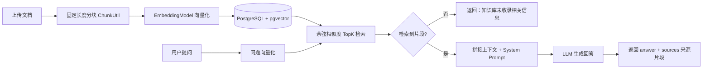

# rag-knowledge-demo

基于 Java 21 + Spring Boot 3.3 + Spring AI 的后端 RAG 知识库 API 服务：文档分块、向量化、pgvector 检索、大模型问答（普通 / SSE 流式）、Agent 工具调用。仅提供 OpenAPI 接口，不做前端页面。

## 技术栈

| 组件 | 版本 / 说明 |
| --- | --- |
| JDK | 21 |
| Spring Boot | 3.3.x |
| Spring AI | 1.0.0-M6（OpenAI 兼容协议） |
| 数据库 | PostgreSQL 15+ + pgvector（向量维度 1536） |
| ORM | MyBatis-Plus 3.5.5 |
| 接口文档 | springdoc-openapi 2.6.0 |
| 模型 | chat：qwen-turbo；embedding：text-embedding-v1 |

## RAG 链路



## 环境准备

1. JDK 21、Maven 3.8+
2. Docker（用于启动 PostgreSQL + pgvector）
3. 通义千问 API Key（DashScope），需支持 OpenAI 兼容模式

## 启动 pgvector

```bash
docker run -d --name rag-pgvector \
  -p 5432:5432 \
  -e POSTGRES_PASSWORD=postgres \
  -e POSTGRES_DB=rag_demo \
  -v pgdata:/var/lib/postgresql/data \
  pgvector/pgvector:pg16
```

初始化表结构与向量索引：

```bash
docker exec -i rag-pgvector psql -U postgres -d rag_demo < src/main/resources/db/init.sql
```

## 编译与启动

设置环境变量（PowerShell 示例）：

```powershell
$env:DASHSCOPE_API_KEY = "sk-xxxxxx"
# 可选：$env:DB_HOST / $env:DB_PORT / $env:DB_NAME / $env:DB_USERNAME / $env:DB_PASSWORD
```

编译打包并启动：

```bash
mvn clean package -DskipTests
java -jar target/rag-knowledge-demo-1.0.0.jar
```

Docker 部署：

```bash
docker build -t rag-knowledge-demo:1.0.0 .
docker run -d --name rag-demo -p 8080:8080 \
  -e DASHSCOPE_API_KEY=sk-xxxxxx \
  -e DB_HOST=host.docker.internal \
  rag-knowledge-demo:1.0.0
```

Swagger UI：<http://localhost:8080/swagger-ui.html>
OpenAPI JSON：<http://localhost:8080/v3/api-docs>
健康检查：<http://localhost:8080/actuator/health>

## 接口与测试用例

### 1. 上传文档入库

```bash
curl -X POST http://localhost:8080/api/doc/upload \
  -H "Content-Type: application/json" \
  -d '{"title":"Spring AI 简介","content":"Spring AI 是 Spring 生态的 AI 应用开发框架，支持对话、Embedding、向量检索与工具调用...","meta":"{\"source\":\"manual\"}"}'
```

返回 `docId`。

### 2. 查询文档分片

```bash
curl http://localhost:8080/api/doc/{docId}/chunks
```

### 3. 普通 RAG 问答

```bash
curl -X POST http://localhost:8080/api/chat \
  -H "Content-Type: application/json" \
  -d '{"question":"Spring AI 是什么？","topK":5}'
```

### 4. SSE 流式问答

```bash
curl -N "http://localhost:8080/api/chat/stream?question=Spring%20AI%20是什么"
```

事件类型：`sources`（来源片段）、`message`（增量文本）、`done`（结束）、`error`（异常）。

### 5. Agent 工具调用

```bash
curl -X POST http://localhost:8080/api/agent/chat \
  -H "Content-Type: application/json" \
  -d '{"question":"现在几点了？"}'
```

```bash
curl -X POST http://localhost:8080/api/agent/chat \
  -H "Content-Type: application/json" \
  -d '{"question":"文档 {docId} 有多少个分片？"}'
```

### 6. 删除文档

```bash
curl -X DELETE http://localhost:8080/api/doc/{docId}
```

## 配置项

| 配置 | 说明 | 默认值 |
| --- | --- | --- |
| `server.port` | 服务端口 | 8080 |
| `spring.ai.openai.base-url` | OpenAI 兼容地址 | 通义千问兼容模式 |
| `spring.ai.openai.api-key` | API Key（环境变量注入） | 无 |
| `spring.ai.openai.chat.options.model` | 对话模型 | qwen-turbo |
| `spring.ai.openai.embedding.options.model` | 向量模型 | text-embedding-v1 |
| `rag.chunk-size` | 分块长度 | 500 |
| `rag.overlap` | 分块重叠 | 100 |
| `rag.top-k` | 检索 TopK | 5 |
| `rag.enable-rag` | RAG 开关，false 时直接裸问 | true |

## 局限与优化方向

1. 分块为固定长度切分，未做语义切分，长文档跨段落语义可能被截断；可引入按标题/段落切分或语义分块。
2. 检索仅使用向量相似度，无关键词混合检索与 Rerank；可引入 BM25 + 向量混合召回并加重排序模型。
3. 无多轮会话记忆与上下文压缩，问答为单轮。
4. 文档为单表存储，无文档主表、版本与权限管理；可扩展 `doc` 主表与权限模型。
5. 入库为逐条 insert，大批量文档可改为批量写入或异步任务队列。
6. 无鉴权、限流、审计日志；生产环境需补充 API Key 鉴权与调用配额。
7. 已在 JDK 25 + Spring Boot 3.3.4 + Spring AI 1.0.0-M6 下验证编译与启动；JDK 23+ 编译需 Lombok 1.18.40+ 并在 maven-compiler-plugin 显式声明 annotationProcessorPaths（pom 已配置）。
